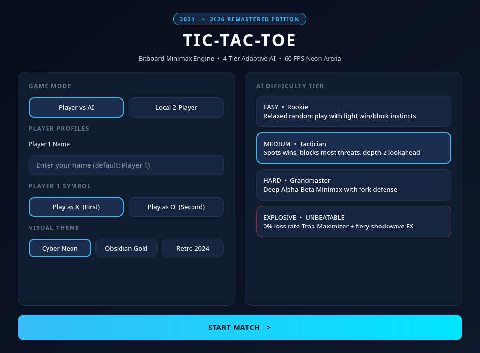
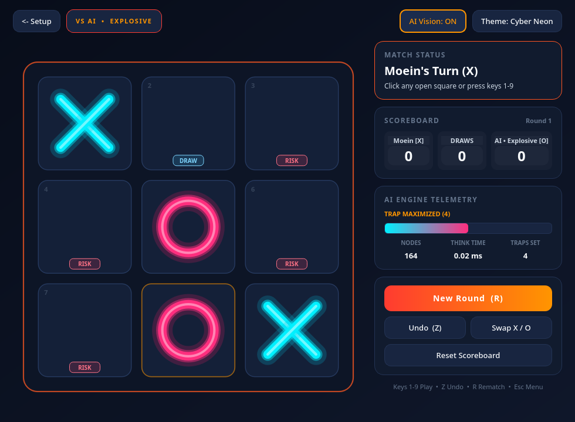
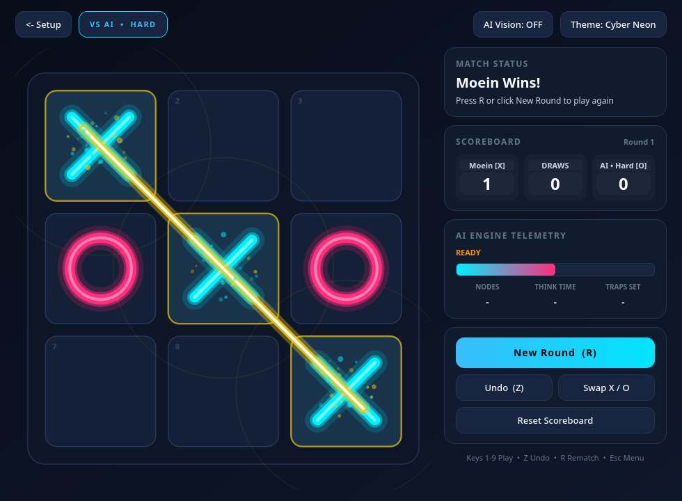
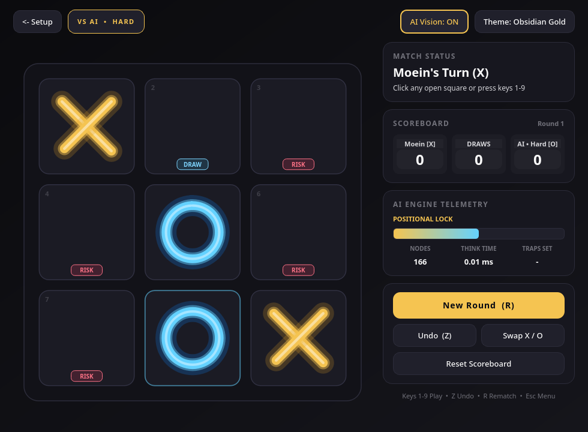
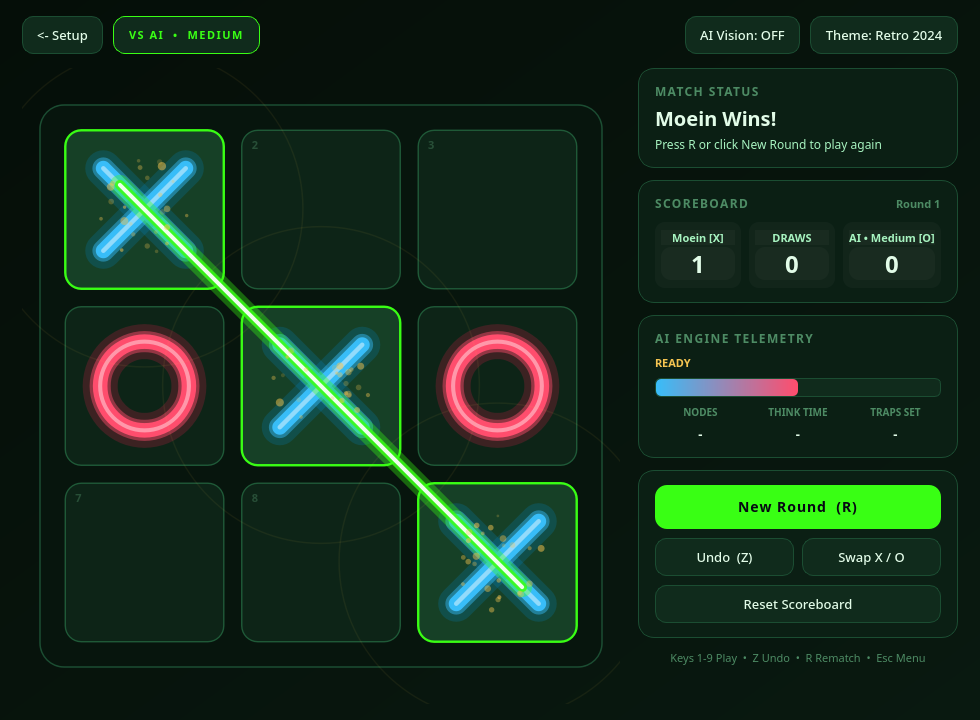
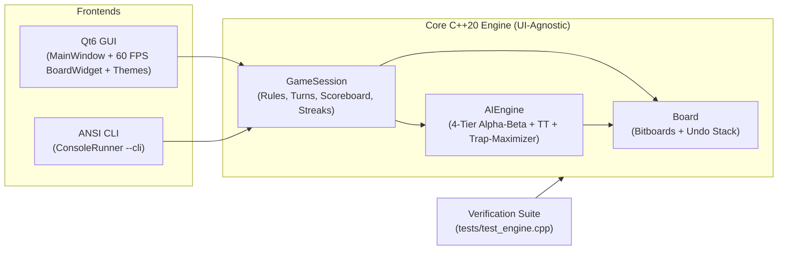

# Tic-Tac-Toe — 2026 Remastered Edition


A modern **2026 C++20 remaster** of one of the very first programs I ever wrote in 2024. What started as a single-file Windows console game with a random-move opponent has been rebuilt from the ground up into a **modular, bitboard-accelerated C++20 game engine** featuring a **60 FPS neon Qt6 graphical interface**, a **4-tier adaptive AI (Easy, Medium, Hard, and mathematically unbeatable Explosive)**, live engine telemetry, an optional **AI Vision** heatmap, a cross-platform ANSI terminal mode, and an automated mathematical verification suite.

> **Nostalgia Preserved:** The original 2024 source code is preserved untouched in [`legacy/TicTacToe_2024.cpp`](legacy/TicTacToe_2024.cpp) so you can compare the full evolution side by side.

---

## Visual Showcase

### Launch Studio & Explosive Overdrive

| Launch & Match Setup (`Cyber Neon`) | Live Arena (`Explosive Overdrive` + `AI Vision`) |
| :---: | :---: |
|  |  |

### Three Built-In Visual Themes

| Cyber Neon *(2026 Default)* | Obsidian Gold *(Minimalist Luxury)* | Retro 2024 *(CRT Console Tribute)* |
| :---: | :---: | :---: |
|  |  |  |

---

## The 2024 → 2026 Glow-Up

| Dimension | 2024 Original (`legacy/TicTacToe_2024.cpp`) | 2026 Remaster (`src/`) |
| :--- | :--- | :--- |
| **Language & Standard** | Single-file procedural C++ | Modular **C++20** (`-Wall -Wextra -Wpedantic`, zero warnings) |
| **Platform Support** | Windows-only (`<windows.h>` Win32 console API) | Cross-platform **Linux, Windows, and macOS** |
| **User Interface** | Basic colored console output | **60 FPS animated Qt6 GUI** + **3 visual themes** + modern cross-platform ANSI `--cli` mode |
| **Board Representation** | `char game_board[3][3]` + redundant `bool check[9]` globals | **Bitboards** (`uint16_t maskX`, `uint16_t maskO`) with `O(1)` bitmask win detection & undo stack |
| **AI Intelligence** | Pure random moves via rejection sampling | **4 distinct AI tiers**: `Easy`, `Medium`, `Hard`, and **unbeatable `Explosive`** (Alpha-Beta + Transposition Table + Trap-Maximizer) |
| **Input Safety** | Unchecked `cin >>` (out-of-bounds UB / infinite loop on bad input) | Mouse + keyboard GUI + bulletproof line-parsed CLI validation |
| **Code Architecture** | 389 lines in `main()` with duplicated PvP/PvC loops | Decoupled `engine` / `gui` / `cli` layers + `GameSession` state machine |
| **Verification** | Manual testing only | **850+ automated checks** including an exhaustive 0-loss proof for Explosive AI |

---

## Key Features

### 60 FPS Animated Graphical Interface (Qt6)
- **Custom `QPainter` Game Canvas (`BoardWidget`)**: Multi-layer neon bloom strokes for `X` and `O` with cubic ease-out drawing animations, pulsing hover ghost previews, last-move highlights, and an animated winning laser beam.
- **Particle & Shockwave Physics**: Spark bursts on every placement, celebratory multi-tile bursts on wins, plus **Explosive Overdrive FX** — fiery crimson-amber ambient plasma aura, expanding shockwave rings, ember explosions, and damped camera shake on Explosive AI strikes.
- **Three Curated Themes**:
  - **Cyber Neon** — Deep midnight glass with electric cyan (`X`) and neon magenta (`O`).
  - **Obsidian Gold** — Minimalist luxury charcoal with champagne gold and arctic ice.
  - **Retro 2024** — CRT phosphor green tribute to the original 2024 terminal edition.
- **Live AI Vision Heatmap**: Toggle **AI Vision** in Player vs AI mode to inspect real-time Minimax classifications (`WIN`, `DRAW`, `RISK`) directly on every open tile.
- **Real-Time AI Telemetry HUD**: Displays the AI's tactical callout (`TRAP MAXIMIZED`, `FORCED WIN IN 2`, `THREAT NEUTRALIZED`, `EXPLOSIVE FORK!`), an evaluation advantage bar, nodes searched, think time in milliseconds, and lethal traps set.
- **Complete Match Quality-of-Life**: Custom player names, persistent scoreboard with live win streaks, round counter, move **Undo** (`Z`), instant **Rematch** (`R`), and **Swap X / O** sides.

### Cross-Platform Modern CLI Mode
- Launch the built-in terminal mode via `./TicTacToe --cli`, or compile a zero-Qt standalone binary (`make cli` → `./TicTacToe-cli`) for lightweight or headless environments.
- Uses standard ANSI escape colors (with automatic Virtual Terminal activation on Windows), clean Unicode box-drawing borders, gold winning-line highlights, undo (`u`), and full input sanitization.

---

## 4-Tier AI Engine Deep Dive

The AI engine (`src/engine/AI.hpp` / `AI.cpp`) is engineered so every tier feels meaningfully different to play against:

| Tier | Codename | Strategy & Algorithm | Beatable? |
| :--- | :--- | :--- | :--- |
| **1. Easy** | *Rookie* | Uniform selection from open cells (no rejection loops), with a 30% chance to spot an immediate 1-move win and 20% chance to block a 1-move threat. | Very forgiving |
| **2. Medium** | *Tactician* | Takes 100% of immediate wins, blocks 85% of immediate threats, and uses a **depth-2 Alpha-Beta search** with a positional/line heuristic and controlled variance. | Beatable via forks & traps |
| **3. Hard** | *Grandmaster* | Full **Alpha-Beta Minimax** with transposition caching, 100% immediate win/block accuracy, and fork defense. Introduces a subtle 14% imperfection only in balanced early positions so sharp players can still earn a win. | Challenging — rewards sharp forks |
| **4. Explosive** | *Unbeatable* | **100% mathematically optimal** Bitboard Minimax + Alpha-Beta Pruning + 18-bit Exact Transposition Table + **Trap-Maximizer** secondary solver, paired with fiery **Explosive Overdrive** visual FX. | **0% loss rate (mathematically proven)** |

### How `Explosive` Works Under the Hood

1. **Bitboard State Representation (`Board.hpp`)**
   - Each player's board state fits in 9 bits of a `uint16_t` (`maskX_`, `maskO_`).
   - Win detection evaluates all 8 winning lines via bitwise `(mask & winMask) == winMask` in `O(1)` time.
   - The entire board packs into an **exact 18-bit integer state key**: `(maskX_ << 9) | maskO_`.

2. **Depth-Invariant Alpha-Beta + Exact Transposition Table**
   - Terminal states are scored as `+(100 - moveCount)` for an AI win, `-(100 - moveCount)` for an AI loss, and `0` for a draw.
   - Because `moveCount` is an intrinsic property of the board state, every cached evaluation is **root-depth invariant** and safely stored in a flat `524,288`-entry `O(1)` transposition table with zero hash collisions.
   - Strategic move ordering (`Center → Corners → Edges`) maximizes Alpha-Beta cutoffs.

3. **The Trap-Maximizer Tie-Breaker**
   - Standard Minimax treats all optimal drawing moves identically. **Explosive** goes further: among every move achieving the highest exact Minimax score, it simulates **all possible human responses** and counts how many human replies immediately hand the AI a forced win (`trapCount`), weighted by win speed and double-fork creation (`trapPressure`).
   - *Emergent Proof*: On an empty board as `X`, Explosive automatically discovers from pure search that playing a **corner** sets **7 lethal traps out of 8** human replies (versus 4 for center), punishing even a single misstep instantaneously.

---

## Code Optimization Audit (2024 → 2026)

Every structural flaw and inefficiency in `legacy/TicTacToe_2024.cpp` was systematically resolved:

1. **Eliminated Windows Lock-In**: Removed `<windows.h>`, `HANDLE hConsole`, and `SetConsoleTextAttribute` in favor of a native Qt6 GUI and cross-platform ANSI CLI.
2. **Removed Global Mutable State & Redundant Arrays**: Replaced globals `game_board[3][3]` and `check[9]` with encapsulated bitboards inside `ttt::Board` (using 4 bytes for the entire grid instead of 18 bytes of duplicated state).
3. **Fixed Undefined Behavior & Input Bugs**: In 2024, entering `0`, `10`, or `"abc"` caused out-of-bounds access `check[player_select - 1]` or infinite `std::cin` failure loops. Every move is now bounds-checked in `Board::makeMove()` and parsed safely via `std::getline` in CLI mode.
4. **Fixed RNG Anti-Pattern & Rejection Loop**: The 2024 AI constructed a brand-new `std::random_device` and `std::mt19937` *inside* every turn and looped `while (check[...])` until stumbling upon an empty square. The 2026 `AIEngine` seeds a single persistent `std::mt19937` once and samples directly from `availableMoves()` in `O(1)`.
5. **Eliminated ~180 Lines of Duplicated Logic**: Unified Player vs Player and Player vs AI turn loops, symbol mapping, win detection, and scoreboard updates into a single clean `ttt::GameSession` controller.
6. **Separated Rendering from Game State**: `Show_Board()` previously mutated `game_board` while printing to `stdout`. The 2026 engine is 100% UI-agnostic and independently unit-testable.

---

## Architecture & Project Structure



```text
TicTacToe/
├── src/
│   ├── engine/
│   │   ├── Board.hpp / Board.cpp         # Bitboard 3x3 state, O(1) win/draw, undo history
│   │   ├── AI.hpp / AI.cpp               # Easy, Medium, Hard & Explosive AI + telemetry
│   │   └── GameSession.hpp / .cpp        # Match state machine, scoreboard & streaks
│   ├── gui/
│   │   ├── Theme.hpp                     # Cyber Neon, Obsidian Gold, Retro 2024 palettes
│   │   ├── BoardWidget.hpp / .cpp        # 60 FPS QPainter canvas, animations & particles
│   │   └── MainWindow.hpp / .cpp         # Setup studio, Arena HUD, AI Vision & shortcuts
│   ├── cli/
│   │   └── ConsoleRunner.hpp / .cpp      # Cross-platform ANSI terminal mode
│   └── main.cpp                          # Entry point (GUI default, --cli flag)
├── tests/
│   └── test_engine.cpp                   # 850+ assertions & exhaustive Explosive 0-loss proof
├── docs/
│   └── screenshots/                      # Rendered GUI previews
├── legacy/
│   └── TicTacToe_2024.cpp                # Preserved original 2024 source code
├── Makefile                              # Direct GNU Make build (GUI, CLI, tests)
├── CMakeLists.txt                        # Cross-platform CMake build (Linux/Windows/macOS)
├── LICENSE                               # MIT License
└── README.md
```

---

## Installation, Building & Running

### Prerequisites
- A **C++20** compiler: GCC 10+, Clang 13+, or MSVC 2022+
- **Qt 6** (`Qt6Widgets`, `Qt6Gui`, `Qt6Core`) for the graphical interface *(optional — standalone CLI builds with zero external dependencies!)*
- `make` + `pkg-config` **or** `cmake` 3.20+

<details>
<summary><strong>Installing Qt6 Dependencies by OS</strong></summary>

- **Arch Linux / Manjaro / EndeavourOS:**
  ```bash
  sudo pacman -S gcc make pkgconf qt6-base
  ```
- **Ubuntu / Debian:**
  ```bash
  sudo apt update && sudo apt install g++ make pkg-config qt6-base-dev
  ```
- **Fedora:**
  ```bash
  sudo dnf install gcc-c++ make pkgconf-pkg-config qt6-qtbase-devel
  ```
- **macOS (Homebrew):**
  ```bash
  brew install cmake qt@6
  ```
- **Windows:** Install Qt 6 via the Qt Online Installer or MSYS2 (`pacman -S mingw-w64-ucrt-x86_64-qt6-base mingw-w64-ucrt-x86_64-cmake mingw-w64-ucrt-x86_64-gcc`).

</details>

### Option A: Build with `make` (Linux / MSYS2)

```bash
git clone https://github.com/DrGhost019/TicTacToe.git
cd TicTacToe

# Build the Qt6 Graphical Edition (default)
make
./TicTacToe

# Run the built-in terminal mode from the same binary
./TicTacToe --cli

# Build a zero-dependency standalone CLI binary (no Qt6 required)
make cli
./TicTacToe-cli

# Compile & run the automated engine verification suite
make test
```

### Option B: Build with `CMake` (Cross-Platform: Windows / macOS / Linux)

```bash
cmake -S . -B build -DCMAKE_BUILD_TYPE=Release
cmake --build build --parallel

# Launch GUI (or pass --cli for terminal mode)
./build/TicTacToe

# Run automated tests via CTest
ctest --test-dir build --output-on-failure
```

To build **CLI-only** with CMake (no Qt6 required):
```bash
cmake -S . -B build-cli -DTTT_CLI_ONLY=ON -DCMAKE_BUILD_TYPE=Release
cmake --build build-cli
```

---

## Controls & Keyboard Shortcuts

Honoring the classic 2024 cell numbering, you can play with either the **mouse** or **number keys `1–9`**:

```text
 1 │ 2 │ 3
───┼───┼───
 4 │ 5 │ 6
───┼───┼───
 7 │ 8 │ 9
```

| Input | Action |
| :--- | :--- |
| **Left Click** or **`1`–`9`** | Place your mark (`X` or `O`) on the corresponding tile |
| **`Z`** *(GUI)* / **`u`** *(CLI)* | Undo the previous turn |
| **`R`** | Start a new round / instant rematch |
| **`Esc`** | Return to the Setup screen |
| **`AI Vision` Button** | Toggle live Minimax `WIN` / `DRAW` / `RISK` overlays on open cells |
| **`Theme` Button** | Cycle between *Cyber Neon*, *Obsidian Gold*, and *Retro 2024* |

---

## Testing & Verification

Run `make test` to execute the verification suite (`tests/test_engine.cpp`), which validates:
- Bitboard placement, bounds safety, occupancy rejection, undo integrity, draw detection, and all 8 winning lines.
- **Exhaustive Mathematical Proof for Explosive AI**: Explores every possible human response tree both when Explosive plays `X` (first) and when Explosive plays `O` (second), asserting **0 losses**.
- **Trap-Maximizer Verification**: Confirms Explosive discovers the optimal 7-trap corner opening.
- **4-Tier Ladder Benchmark**: Simulates 200 matches per difficulty tier to verify skill separation.
- **GameSession State Machine**: Verifies score tracking, streaks, blank-name fallback, undo score rollback, and side swapping.

Sample output:
```text
Running Tic-Tac-Toe 2026 Engine Verification Suite...
  [Explosive Exhaustive Proof]
    As X: 76 terminal lines (72 wins, 4 draws, 0 losses)
    As O: 489 terminal lines (372 wins, 117 draws, 0 losses)
    Verified in 2.20 ms
  [200-Game Ladder vs Naive Opponent]
    Easy:      122W / 50L
    Medium:    182W / 3L
    Hard:      177W / 1L
    Explosive: 184W / 0L
ALL 850 CHECKS PASSED!
```

---

## Author

**Mohammad Moein Kashefi Nejad**  
- Email: `moeinkashefinejad@gmail.com`  
- GitHub: [https://github.com/DrGhost019](https://github.com/DrGhost019)

---

## License

This project is licensed under the **MIT License** — see the [LICENSE](LICENSE) file for details.
